# AlimentaVES

**HackODS UA 2026 · Villa El Salvador**

AlimentaVES es una plataforma web que busca conectar donantes de alimentos con comedores populares. Con el proyecto queremos ayudar a aprovechar alimentos aptos para consumo que, de otro modo, podrían desperdiciarse.

Nuestro trabajo se relaciona con el **ODS 2 (Hambre Cero)** y el **ODS 12 (Producción y Consumo Responsables)**.

## Alcance y estado del proyecto

- **Reto oficial:** Alimentación solidaria, HackODS UA 2026.
- **Ámbito:** Villa El Salvador, Lima, Perú.
- **Interfaz:** rediseño Nature integrado en la rama `main`.
- **API:** FastAPI, con desarrollo adicional de backend en curso fuera de `main`.
- **Demostración:** se ejecuta en entorno local o entorno de pruebas; no se documenta aquí una URL de producción pública verificada.
- **Datos:** el directorio ha sido probado con 242 registros oficiales de comedores de Villa El Salvador.

El objetivo es facilitar la conexión entre donantes y comedores y reducir el desperdicio de alimentos aptos para consumo. **No se presentan cifras de prueba como impacto social real**.

## Integrantes

| Integrante | Responsabilidad |
| --- | --- |
| Jesus Anthony Garamendi Gonzales | Backend, API y base de datos |
| Diego Manuel Pizango Chanchari | Frontend e integración |

## ¿Cómo funciona?

1. El donante registra el alimento, su cantidad, la fecha de vencimiento y el punto de recojo.
2. Las donaciones disponibles aparecen en la plataforma.
3. Un comedor puede reservar una donación.
4. Al confirmar la entrega, se actualizan las estadísticas.

Las donaciones de la demostración emplean información ficticia. El catálogo de comedores parte de registros oficiales públicos de Villa El Salvador; su aparición en el directorio **no acredita actividad operativa actual**. Para usar donaciones reales se requieren controles de seguridad alimentaria, verificación de participantes y protección de datos.

## Galería del prototipo Nature

Capturas **reales de la interfaz** tomadas durante las pruebas del rediseño Nature. Estas imágenes muestran el prototipo, **no un despliegue público confirmado**.

<p align="center">
  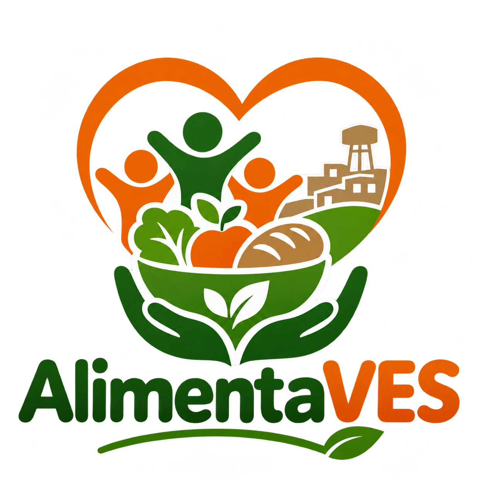
</p>

### Página de inicio — escritorio

<p align="center">
  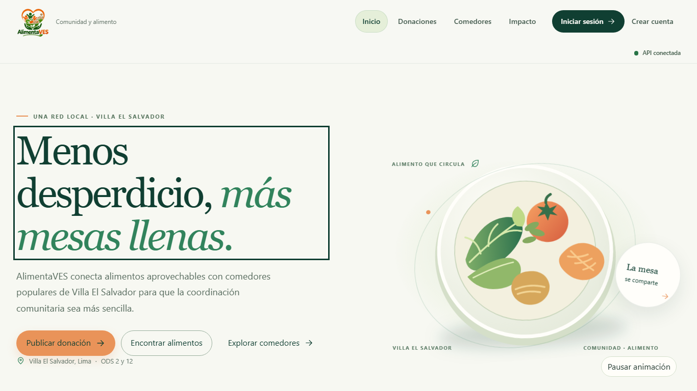
</p>

### Diseño adaptable

<table>
  <tr>
    <th>Teléfono (390 × 844)</th>
    <th>Teléfono compacto (360 × 800)</th>
    <th>Tablet (768 × 1024)</th>
  </tr>
  <tr>
    <td align="center">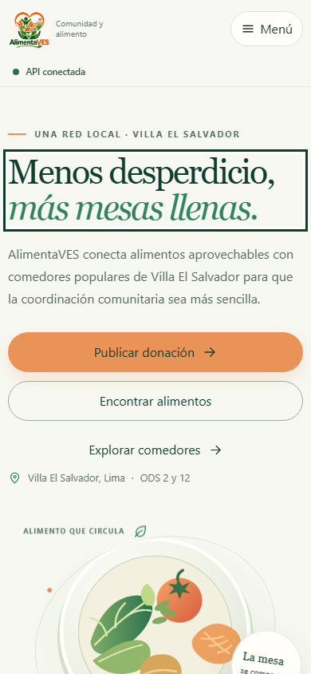</td>
    <td align="center">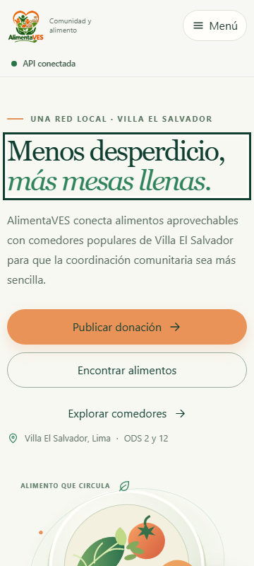</td>
    <td align="center">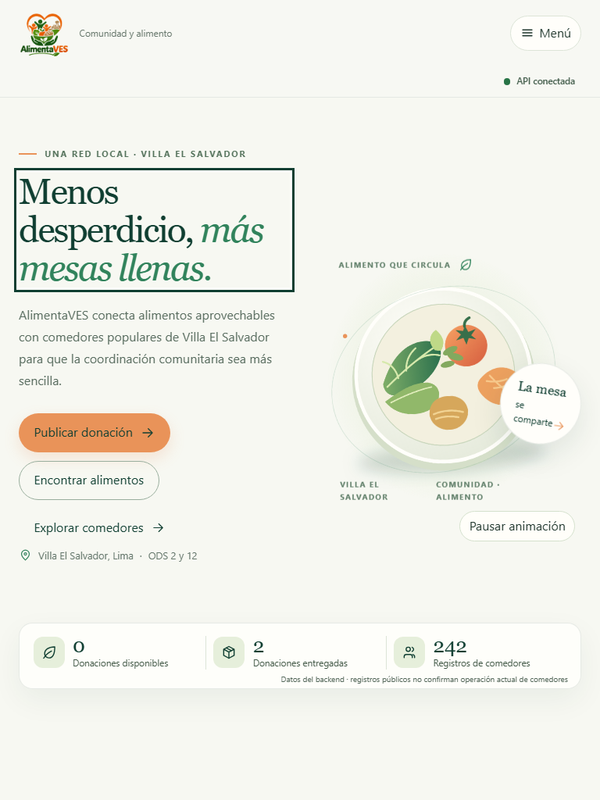</td>
  </tr>
</table>

### Escritorio ancho (1920 × 1080)

<p align="center">
  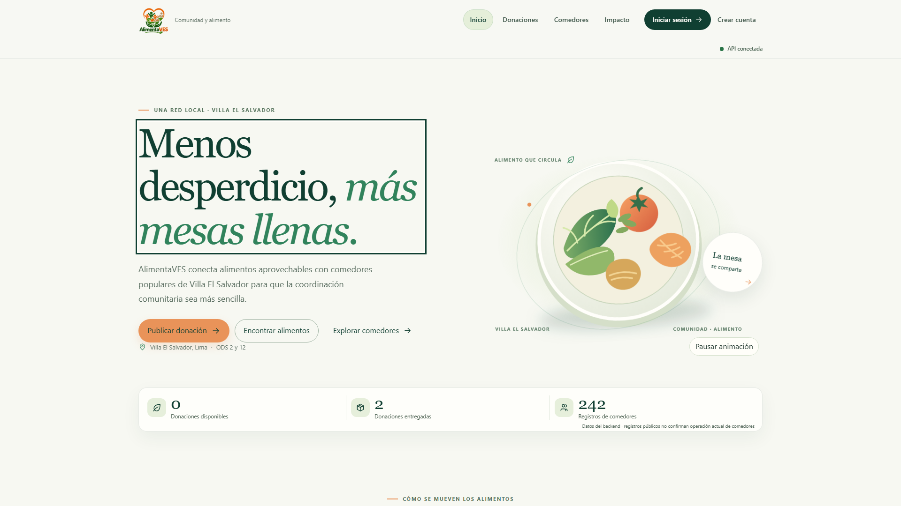
</p>

### Directorio y mapa de comedores

<p align="center">
  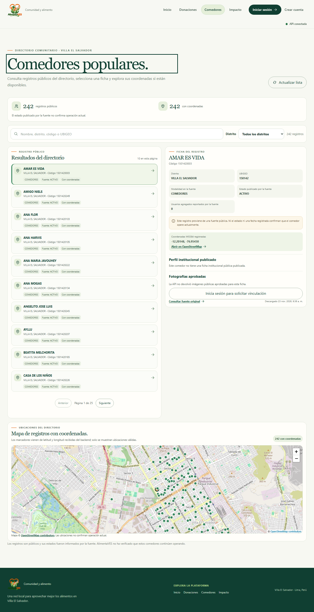
</p>

El mapa utiliza [Leaflet](https://leafletjs.com/) y datos públicos geográficos de Villa El Salvador. **Un registro en el directorio no implica que el comedor siga operando actualmente**. Mapa y teselas © [colaboradores de OpenStreetMap](https://www.openstreetmap.org/copyright).

### Recursos gráficos de alimentos

| Caja solidaria | Verduras frescas | Canasta de frutas |
|:---:|:---:|:---:|
| 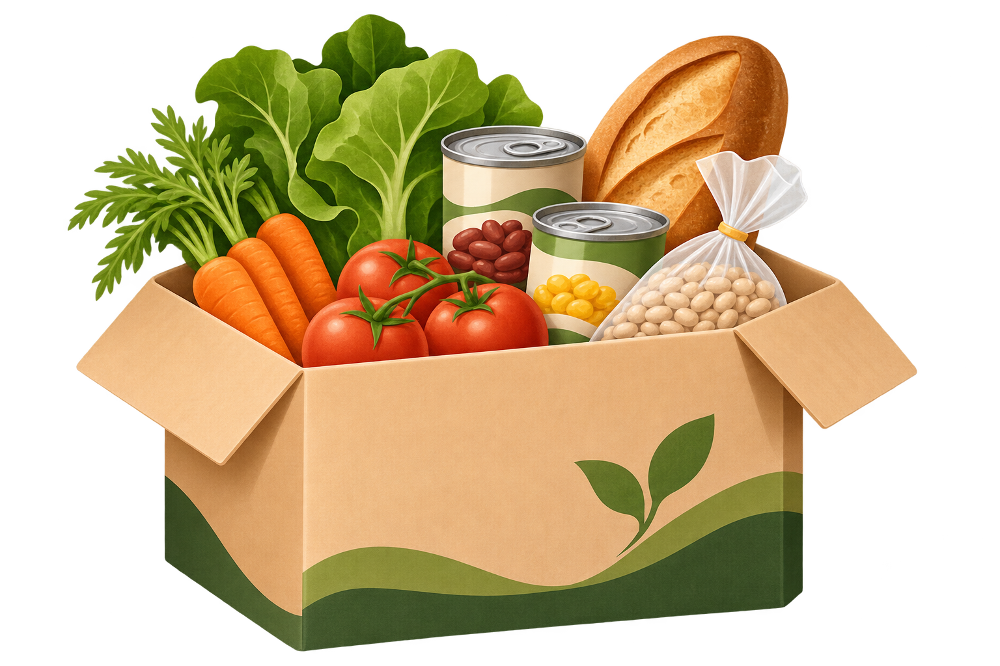 |  |  |

| Olla comunitaria | Arroz | Menú preparado |
|:---:|:---:|:---:|
|  | 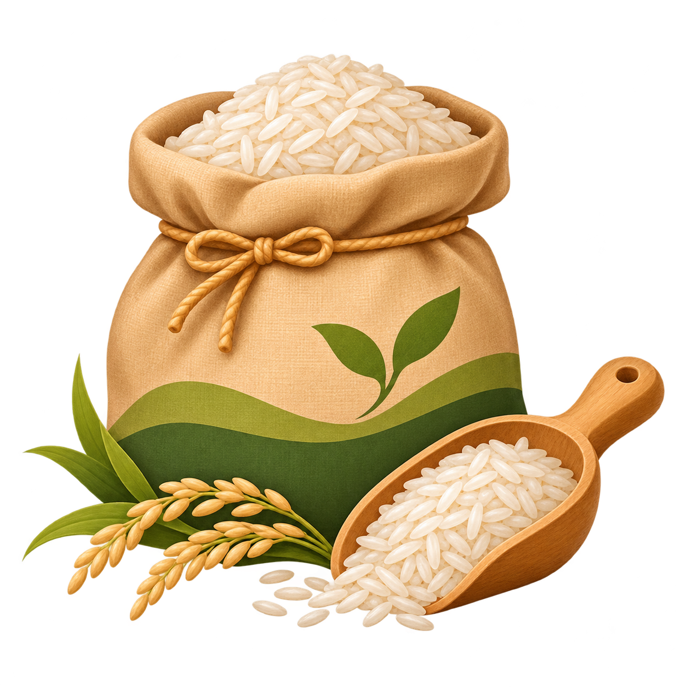 | 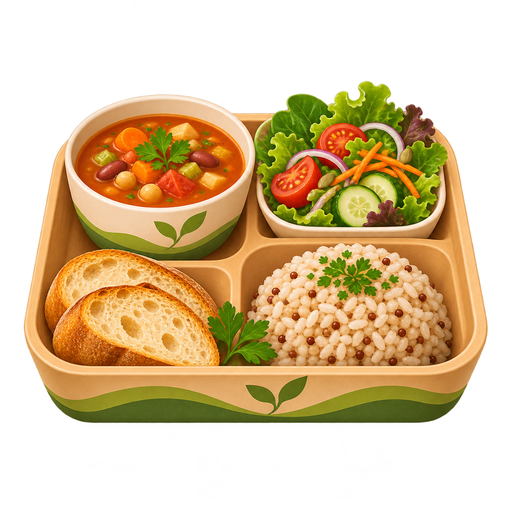 |

### Fotografías de alimentos utilizadas en la interfaz

<table>
  <tr>
    <td align="center">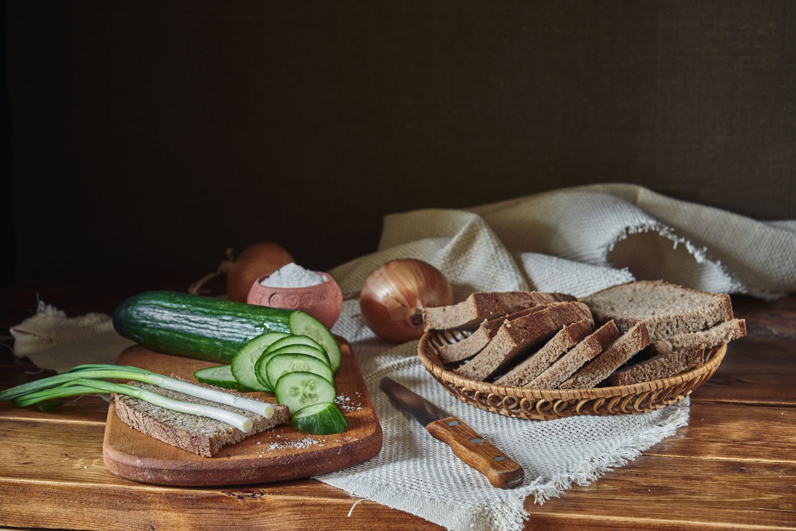</td>
    <td align="center"></td>
  </tr>
  <tr>
    <td align="center">Pan y vegetales</td>
    <td align="center">Sopa de verduras</td>
  </tr>
</table>

**Aviso:** las ilustraciones y fotografías son **referenciales**, no evidencias de donaciones entregadas ni de condiciones actuales de los comedores. Origen, licencias y autores: [ASSETS.md](front/public/assets/alimentos/ASSETS.md). Las fotos se obtuvieron de [Pexels](https://www.pexels.com/license/), y los ingredientes complementarios del repositorio [Culinary Assets, CC0](https://github.com/cosmintrica/culinary-assets).

[Ver todas las capturas en Google Drive](https://drive.google.com/drive/folders/1G3Jr64bnQ4a7eegU7J-uZV-cV3YMojiV)

## Funciones del prototipo

- **Donantes:** explorar y publicar donaciones, consultar detalles y seguir estados según los permisos y endpoints disponibles.
- **Comedores:** consultar el directorio geográfico, la ficha de cada comedor y los flujos de vinculación o solicitud implementados.
- **Administración:** vistas de gestión y moderación que dependen de los permisos y de la versión del backend conectada.
- **Interfaz Nature:** diseño responsive, ilustraciones, recursos fotográficos con atribución y mapa interactivo.

> **Limitaciones de seguridad conocidas:** en la versión revisada, algunas operaciones de publicación, reserva y entrega necesitan restricciones adicionales del lado del servidor. El backend también debe controlar la divulgación de datos personales en las respuestas de donaciones. Ocultarlos en React **no constituye protección**. No se debe utilizar con datos personales reales hasta resolver estas limitaciones.

## Tecnologías

- **Frontend:** React, TypeScript y Vite.
- **Backend:** Python, FastAPI y Pydantic.
- **Base de datos:** PostgreSQL 16.
- **Entorno de desarrollo:** Docker Compose.

## Organización del repositorio

```text
AlimentaVES/
├── back/                  API y pruebas de backend
├── front/                 Interfaz y cliente HTTP
├── docker/postgres/init/  Base de pruebas
├── docs/                  Arquitectura, fases y contrato de API
└── compose.yaml           Servicios PostgreSQL, backend y frontend
```

## Instalación

Se necesita Git y Docker con Compose instalado.

```bash
git clone https://github.com/Anthgg/AlimentaVES.git
cd AlimentaVES
docker compose up --build -d
docker compose ps
```

Direcciones del proyecto:

| Servicio | Dirección |
| --- | --- |
| Aplicación web | http://localhost:5173 |
| Documentación de API | http://localhost:8000/docs |
| Estado de API | http://localhost:8000/api/health |
| PostgreSQL | localhost:5433 |

Para consultar los registros:

```bash
docker compose logs -f
```

Para detener el proyecto sin borrar la información:

```bash
docker compose down
```

La información de PostgreSQL se conserva en un volumen Docker. El comando `docker compose down -v` elimina los volúmenes y no debe utilizarse para detener el trabajo diario.

## Desarrollo

Tenemos separadas las carpetas de backend y frontend para avanzar en paralelo. Los endpoints y campos JSON se encuentran en [el contrato de API](docs/API_CONTRACT.md), mientras que las actividades y horarios están en [nuestro plan de fases](docs/FASES.md).

También dejamos las instrucciones de cada parte en [back/README.md](back/README.md) y [front/README.md](front/README.md).

## Entregables HackODS

- Repositorio GitHub con documentación y fuentes.
- Prototipo navegable y flujo de demostración de publicación, reserva y entrega de alimentos.
- Presentación oral de **2 a 3 minutos**, con **máximo cinco diapositivas** si se usa presentación.
- Evidencias de interfaz y mapa, disponibles en la [galería de capturas](docs/capturas/).

Las capturas documentan la interfaz; la ejecución de funciones que escriben datos se debe validar con una base de pruebas aislada.

**Proyecto desarrollado por Jesus Anthony Garamendi Gonzales y Diego Manuel Pizango Chanchari.**
