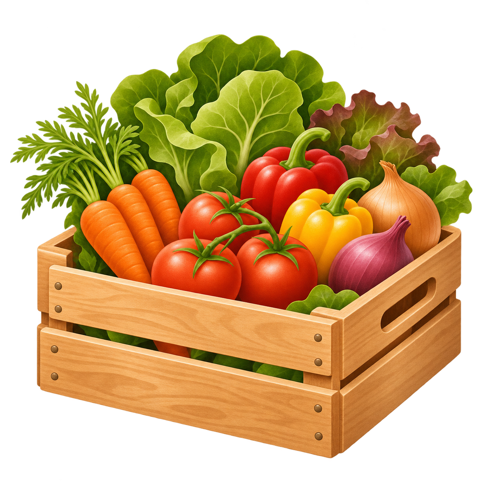
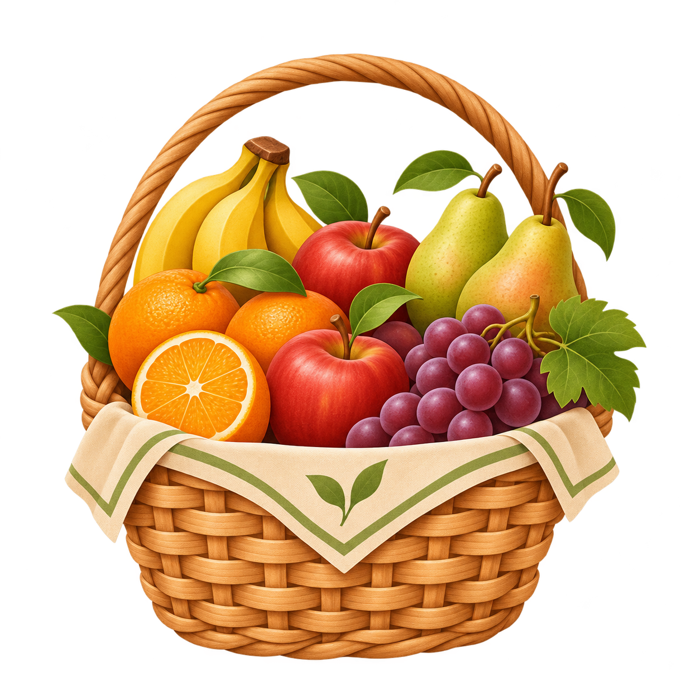

# AlimentaVES

**HackODS UA 2026 · Villa El Salvador**

AlimentaVES es una plataforma web que busca conectar donantes de alimentos con comedores populares. Con el proyecto queremos ayudar a aprovechar alimentos aptos para consumo que, de otro modo, podrían desperdiciarse.

Nuestro trabajo se relaciona con el **ODS 2 (Hambre Cero)** y el **ODS 12 (Producción y Consumo Responsables)**.

## Integrantes

| Integrante | Responsabilidad |
| --- | --- |
| Jesus Anthony Garamendi Gonzales | Backend, API y base de datos |
| Diego Manuel Pizango Chanchari | Frontend e integración |

## ¿Cómo funciona?

1. El donante registra el alimento, su cantidad, la fecha de vencimiento y el punto de recojo.
2. Las donaciones disponibles aparecen en la plataforma.
3. Un comedor puede reservar una donación.
4. Al confirmar la entrega, se actualizan las estadísticas.

Las donaciones de la demostración emplean información ficticia. El catálogo de comedores parte de registros oficiales públicos de Villa El Salvador; su aparición en el directorio **no acredita actividad operativa actual**. Para usar donaciones reales se requieren controles de seguridad alimentaria, verificación de participantes y protección de datos.

## Vista previa de AlimentaVES Nature

Diseño Nature: identidad verde bosque, componentes accesibles, navegación responsive, ilustraciones de alimentos y directorio cartográfico.

<p align="center"></p>

| Caja solidaria | Verduras frescas | Canasta de frutas |
|:---:|:---:|:---:|
|  |  |  |

| Olla comunitaria | Arroz | Menú preparado |
|:---:|:---:|:---:|
|  |  |  |

Las imágenes superiores son **ilustrativas**, no representan fotografías verificadas de donaciones o comedores. Procedencia y créditos: [inventario de recursos](front/public/assets/alimentos/ASSETS.md).

**Capturas reales del frontend:**

- [Landing escritorio 1366 × 768](https://drive.google.com/file/d/1D2kXZ1S_CvIABd7I7VZMBkFwB__SeCLe/view)
- [Landing móvil 390 × 844](https://drive.google.com/file/d/1c5dS6A-fPoE2IsFJOzIYFemYguCASkDC/view)
- [Landing escritorio 1920 × 1080](https://drive.google.com/file/d/11lmIKDNqsXIVZ-t2oGv7YRAx8a9NQSzH/view)
- [Mapa de comedores](https://drive.google.com/file/d/1QZzfptwYTxk4bGl-2mTJvlv8Fa_l--e8/view)
- [Todas las capturas responsive](https://drive.google.com/drive/folders/1G3Jr64bnQ4a7eegU7J-uZV-cV3YMojiV)

## Tecnologías

- **Frontend:** React, TypeScript y Vite.
- **Backend:** Python, FastAPI y Pydantic.
- **Base de datos:** PostgreSQL 16.
- **Entorno de desarrollo:** Docker Compose.

## Organización del repositorio

```text
AlimentaVES/
├── back/                  API y pruebas de backend
├── front/                 Interfaz y cliente HTTP
├── docker/postgres/init/  Base de pruebas
├── docs/                  Arquitectura, fases y contrato de API
└── compose.yaml           Servicios PostgreSQL, backend y frontend
```

## Instalación

Se necesita Git y Docker con Compose instalado.

```bash
git clone https://github.com/Anthgg/AlimentaVES.git
cd AlimentaVES
docker compose up --build -d
docker compose ps
```

Direcciones del proyecto:

| Servicio | Dirección |
| --- | --- |
| Aplicación web | http://localhost:5173 |
| Documentación de API | http://localhost:8000/docs |
| Estado de API | http://localhost:8000/api/health |
| PostgreSQL | localhost:5433 |

Para consultar los registros:

```bash
docker compose logs -f
```

Para detener el proyecto sin borrar la información:

```bash
docker compose down
```

La información de PostgreSQL se conserva en un volumen Docker. El comando `docker compose down -v` elimina los volúmenes y no debe utilizarse para detener el trabajo diario.

## Desarrollo

Tenemos separadas las carpetas de backend y frontend para avanzar en paralelo. Los endpoints y campos JSON se encuentran en [el contrato de API](docs/API_CONTRACT.md), mientras que las actividades y horarios están en [nuestro plan de fases](docs/FASES.md).

También dejamos las instrucciones de cada parte en [back/README.md](back/README.md) y [front/README.md](front/README.md).

## Entregables

- Repositorio con código y documentación.
- Demostración funcional del registro, reserva y entrega de alimentos.
- Presentación de tres minutos con un máximo de cinco diapositivas.

**Proyecto desarrollado por Jesus Anthony Garamendi Gonzales y Diego Manuel Pizango Chanchari.**
