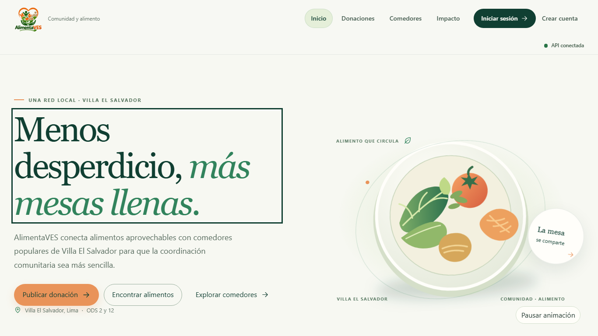
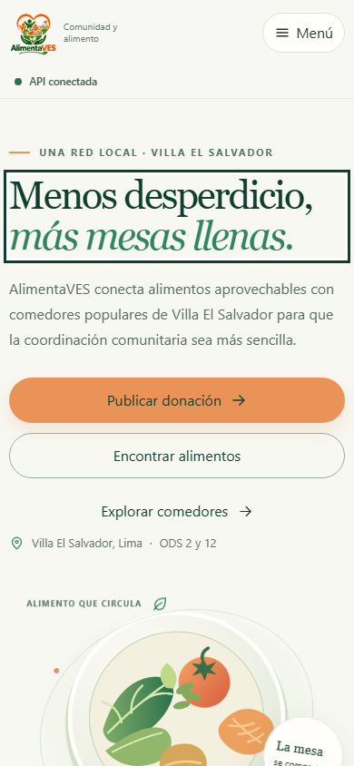
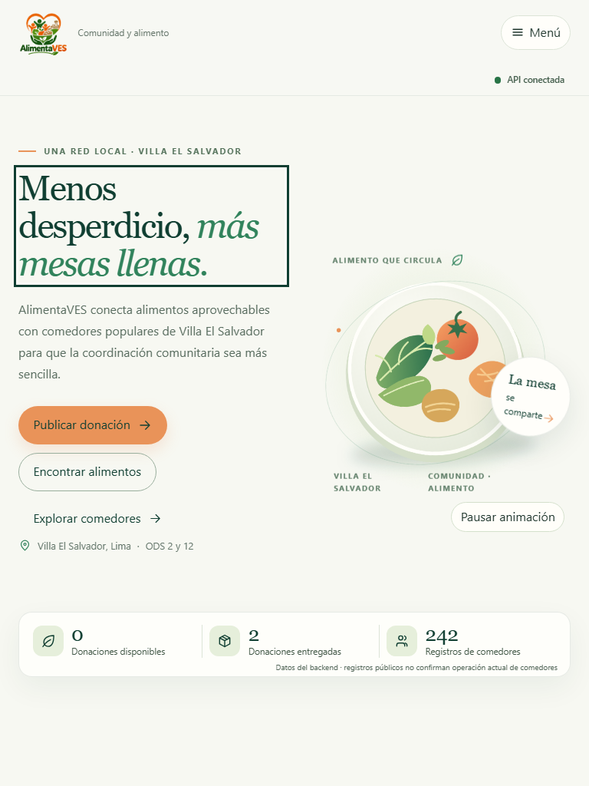
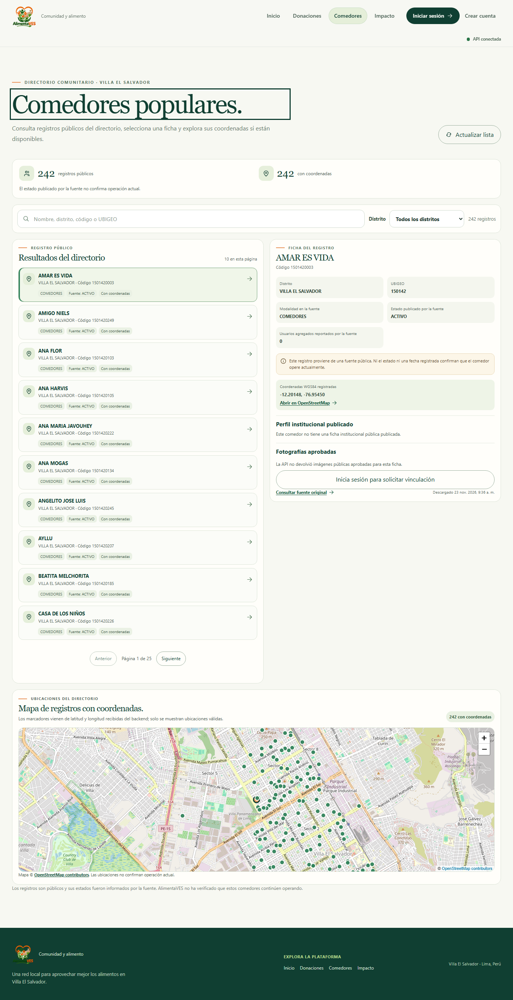

# Frontend de AlimentaVES

**Responsable:** Diego Manuel Pizango Chanchari

Este módulo implementa la interfaz **AlimentaVES Nature**, integrada en la rama principal del proyecto, para explorar alimentos disponibles, consultar comedores populares y navegar por flujos de donación, vinculación y administración. Las operaciones dependen de la API FastAPI conectada.

## Capturas del frontend



| Móvil | Tablet |
|:---:|:---:|
|  |  |



[Galería completa y recursos visuales](../README.md#galería-del-prototipo-nature) · [Fuentes y licencias](public/assets/alimentos/ASSETS.md)

## Tecnologías

- React
- TypeScript
- Vite
- CSS y estilos Nature
- Leaflet y OpenStreetMap para mapas
- Motion para microinteracciones accesibles
- API REST del backend FastAPI

La base de datos es PostgreSQL. El frontend no se conecta directamente a ella; utiliza la API del backend.

## Cómo ejecutarlo

Desde la raíz del repositorio:

```bash
docker compose up --build -d
```

La aplicación estará en http://localhost:5173.

Para trabajar sin Docker:

```bash
cd front
npm install
npm run dev
```

## Vistas disponibles

La navegación se gestiona mediante el parámetro `?vista=` y contempla:

| Vista | Identificador |
| --- | --- |
| Inicio | `inicio` |
| Iniciar sesión | `login` |
| Registro | `registro` |
| Catálogo | `donaciones` |
| Publicar donación | `publicar` |
| Directorio de comedores | `comedores` |
| Impacto | `impacto` |
| Panel de comedor | `panel-comedor` |
| Administración | `administracion` |
| Notificaciones | `notificaciones` |

La visibilidad de las opciones y la autorización de operaciones deben corresponder al usuario autenticado y a las reglas del backend.

## Integración con el backend

El cliente HTTP se encuentra en `src/lib/api.ts`. Los endpoints disponibles son:

| Función | Endpoint |
| --- | --- |
| Listar donaciones | GET /api/donations |
| Consultar detalle | GET /api/donations/{id} |
| Crear donación | POST /api/donations |
| Reservar | PATCH /api/donations/{id}/reserve |
| Confirmar entrega | PATCH /api/donations/{id}/deliver |
| Ver estadísticas | GET /api/stats |
| Listar comedores populares | GET /api/community-kitchens |
| Consultar comedor | GET /api/community-kitchens/{id} |

El contrato con ejemplos de peticiones y respuestas está en [API_CONTRACT.md](../docs/API_CONTRACT.md).

## Comedores y OpenStreetMap

El directorio consume las coordenadas WGS84 de `GET /api/community-kitchens` y las visualiza mediante **Leaflet** con teselas de OpenStreetMap. Los enlaces de localización dependen de los controles implementados y no deben inventar direcciones o coordenadas.

El mapa incluye atribución a OpenStreetMap contributors. La ubicación y el estado del comedor proceden de la fuente pública indicada por el backend; no representan una verificación de operación actual.

## Comprobación y compilación

Desde `front/`:

```bash
npm ci
npm run build
npm run preview
```

Desde Docker Compose:

```bash
docker compose exec front npm run build
```

La compilación correcta **no sustituye** las pruebas funcionales contra la API y una base aislada.

## Consideraciones de la demo

- Las fotografías de comida son **ilustrativas**; ver [ASSETS.md](public/assets/alimentos/ASSETS.md).
- Los registros de comedores proceden de datos públicos y **no certifican su funcionamiento actual**.
- Algunas restricciones de autenticación y privacidad deben reforzarse en el backend antes de utilizar datos reales.
- El proxy de Vite para `/api` solo cubre desarrollo. Un despliegue real requiere configurar explícitamente la conexión segura entre frontend y FastAPI.

## Evidencias

- [Pruebas visuales responsive](../docs/capturas/)
- [README principal y presentación del proyecto](../README.md)
- [Plan de fases](../docs/FASES.md)
